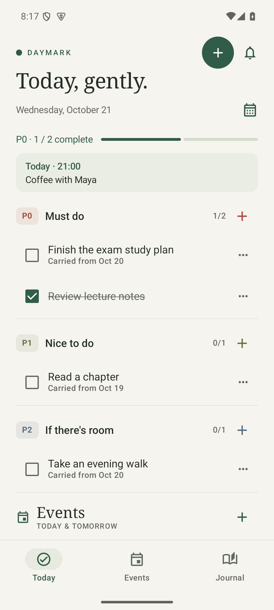
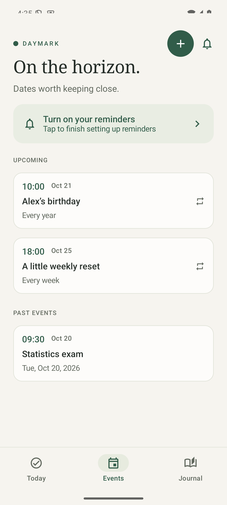
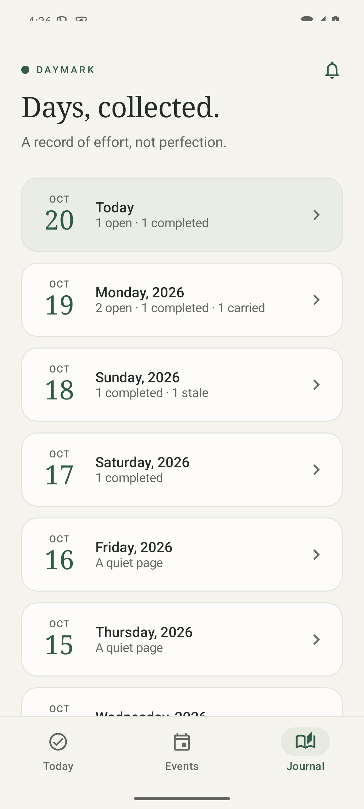

# Daymark

**Make room for what matters.**

A quiet Android planner for daily priorities, upcoming events, and a record of your days. Keep a private local planner, or connect a shared list with Supabase Free.

## Design principles

- **Put the day first.** Must-do tasks and the next event come before decoration. A compact header leaves room for the work itself.
- **Keep priorities clear.** P0 is a must-do; P1 and P2 are nice to do. Every unfinished task carries forward until it is completed, marked stale, or deleted.
- **Make calm useful.** Warm paper, forest green, serif headings, and simple icons create a consistent visual language. Clear labels and restrained spacing keep it practical.
- **Respect attention and intent.** Add or complete a task in a few taps. Protect unsaved changes, preserve edits through rotation, and let layouts adapt to larger system text.
- **Choose what to share.** Original local data stays on the phone. Shared lists use Supabase Auth and PostgreSQL, with isolated SQLite caches and per-device reminder state.

## Screenshots

<table>
  <tr>
    <th>Today</th>
    <th>Events</th>
    <th>Journal</th>
  </tr>
  <tr>
    <td></td>
    <td></td>
    <td></td>
  </tr>
  <tr>
    <td>See what matters today.</td>
    <td>Keep important dates close.</td>
    <td>Look back without losing context.</td>
  </tr>
</table>

Screenshots use illustrative local data.

## Features

### Daily priorities

Each day has three task sections and an Events section:

| Priority | Meaning | Unfinished tasks |
| --- | --- | --- |
| **P0** | Must do | Automatically carried to the next day |
| **P1** | Nice to do | Automatically carried to the next day |
| **P2** | If there is room | Automatically carried to the next day |

- Add, edit, delete, complete, or mark a task **Stale**. Switch freely between P0, P1, and P2.
- **Stale** means no longer needed: the record stays in history and stops carrying forward. Deletion removes that day's entry.
- Days change at **midnight in your phone's local time**. Unfinished P0, P1, and P2 tasks catch up to today even after several days away.
- Tap the date to open the calendar. **Journal** shows previous days with open, completed, carried, and stale counts, including quiet days.

### Events and reminders

- Create one-time events or repeats that run **daily, weekly, monthly, or yearly**. Every event has a date and a time precise to the minute.
- Receive two notifications: **24 hours before** and **30 minutes before** each occurrence. Local events use the phone's time zone; shared events use the shared list's time zone.
- Today's Events section shows today's occurrences and tomorrow's preview. A compact preview near the top highlights the next event.
- Monthly and yearly repeats retain their original date: January 31 returns to March 31 after February, and February 29 returns in leap years.
- Edit or delete an event to update its future reminders. Past one-time events remain available in Events.

Allow notifications and precise reminders through the bell button. Android may delay reminders without precise alarm access; it cannot deliver them while the phone is off or the app is force-stopped.

### Shared lists (Supabase Free)

Open **Shared lists** to configure your project URL and publishable key, sign in, create a list, or join with an invitation code. Members can edit the same tasks and events. The owner can rotate invitations and remove members. Edits require a connection; saved data is readable offline. The foreground app refreshes every 15 seconds, on resume, and after saves. It does not subscribe to Realtime or sync while closed.

Run `supabase/migrations/202611040001_daymark.sql` once in your own Supabase project first. The app uses its authenticated RPC API; private tables are not exposed. No service-role key belongs in the app. See [free setup and migration instructions (中文)](docs/SUPABASE_SETUP.md).

Original local data can be explicitly imported once into a shared list, including history. The original database remains separate and can still be used locally. Shared tasks roll over on the server using the list's fixed time zone. Shared event times and reminders use that zone; notification delivery state remains local to each device. Concurrent edits use revision checks instead of silently overwriting changes.

### Local data and privacy

Original tasks and events remain in app-private SQLite. Without connecting a shared list, the app works locally. Shared list content is uploaded to your configured Supabase project and is accessible to its members and project administrators. Access and refresh tokens are encrypted with Android Keystore; account/project/list caches are isolated. There is no analytics. Android cloud backup and device transfer remain disabled. Uninstalling the app deletes local data and unsynced state.

The interface is entirely in English. Android 8.0 (API 26) or later is supported.
