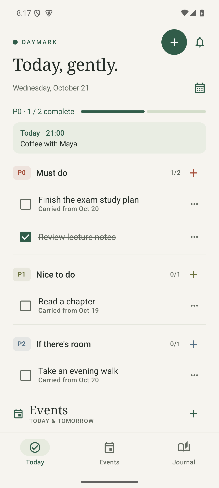
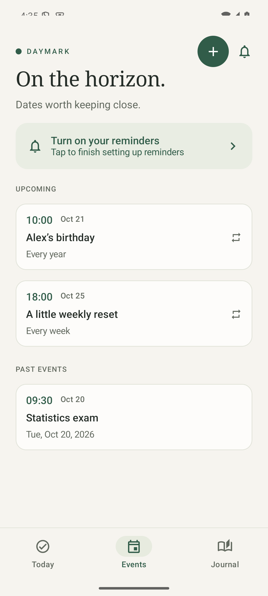
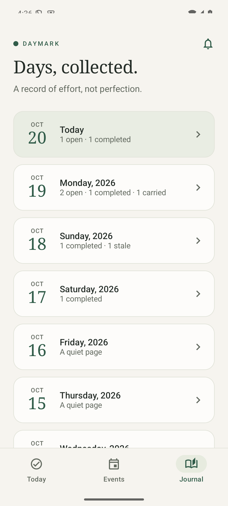

# Daymark

**Make room for what matters.**

A quiet Android planner for daily priorities, upcoming events, and a record of your days. Everything stays on your phone.

## Design principles

- **Put the day first.** Must-do tasks and the next event come before decoration. A compact header leaves room for the work itself.
- **Keep optional things optional.** P0 carries forward automatically; P1 and P2 move only when you choose. An unfinished nice-to-do does not become an obligation.
- **Make calm useful.** Warm paper, forest green, serif headings, and simple icons create a consistent visual language. Clear labels and restrained spacing keep it practical.
- **Respect attention and intent.** Add or complete a task in a few taps. Protect unsaved changes, preserve edits through rotation, and let layouts adapt to larger system text.
- **Stay private and lightweight.** Local SQLite, native Android components, and a small set of vector icons keep the app independent of accounts, servers, and heavy assets.

## Screenshots

<table>
  <tr>
    <th>Today</th>
    <th>Events</th>
    <th>Journal</th>
  </tr>
  <tr>
    <td></td>
    <td></td>
    <td></td>
  </tr>
  <tr>
    <td>See what matters today.</td>
    <td>Keep important dates close.</td>
    <td>Look back without losing context.</td>
  </tr>
</table>

Screenshots use illustrative local data.

## Features

### Daily priorities

Each day has three task sections and an Events section:

| Priority | Meaning | Unfinished tasks |
| --- | --- | --- |
| **P0** | Must do | Automatically carried to the next day |
| **P1** | Nice to do | You choose whether to carry them forward |
| **P2** | If there is room | You choose whether to carry them forward |

- Add, edit, delete, complete, or mark a task **Stale**. Switch freely between P0, P1, and P2.
- **Stale** means no longer needed: the record stays in history and stops carrying forward. Deletion removes that day's entry.
- Days change at **midnight in your phone's local time**. Unfinished P0 tasks catch up to today even after several days away.
- **Review carry-over** lets you move older P1/P2 tasks to today individually or in bulk, or keep them in history. Unreviewed tasks remain available later.
- Tap the date to open the calendar. **Journal** shows previous days with open, completed, carried, and stale counts, including quiet days.

### Events and reminders

- Create one-time events or repeats that run **daily, weekly, monthly, or yearly**. Every event has a date and a time precise to the minute.
- Receive two notifications: **24 hours before** and **30 minutes before** each occurrence. Times follow your phone's local time zone.
- Today's Events section shows today's occurrences and tomorrow's preview. A compact preview near the top highlights the next event.
- Monthly and yearly repeats retain their original date: January 31 returns to March 31 after February, and February 29 returns in leap years.
- Edit or delete an event to update its future reminders. Past one-time events remain available in Events.

Allow notifications and precise reminders through the bell button. Android may delay reminders without precise alarm access; it cannot deliver them while the phone is off or the app is force-stopped.

### Private by default

Tasks and events live in two app-private SQLite tables on the phone. There is no account, sync, analytics, remote storage, or export. Cloud backup and device transfer are disabled. Uninstalling the app deletes its data.

The interface is entirely in English. Android 8.0 (API 26) or later is supported.

## Build

Open the project in Android Studio and run `app`, or use JDK 17 and Android SDK 36 with `ANDROID_HOME` configured:

```sh
./gradlew assembleRelease
adb install -r app/build/outputs/apk/release/app-release.apk
```

The optimized release is about **1.3 MB**, with unused code and resources removed. It uses the local debug signing key for personal sideloading; updates need the same key to preserve the existing installation. Store distribution requires a private signing configuration.

The app is unreleased. Recreate development databases after schema changes; backward-compatible migrations are not maintained yet.

Built with Kotlin, Jetpack Compose, SQLite, and Android AlarmManager. Runtime use is entirely offline.

Numbered SQL files in [`database/`](database/0001.sql) manage the database schema and its indexes. The app executes `0001.sql` for the initial version; future changes add `0002.sql`, `0003.sql`, and so on, and increment `SCHEMA_VERSION` in `DaymarkDatabase`. Creation applies all versions; upgrades apply only newer versions, in order. Keep numbered scripts as semicolon-separated SQL statements. Pending notification times use indexed Unix epoch seconds; reminder state stays on each event.
